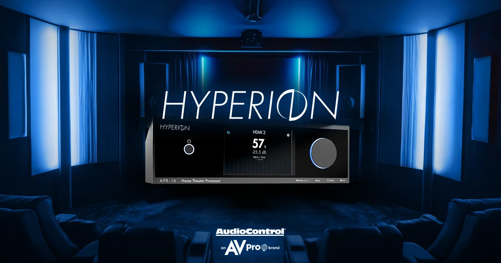
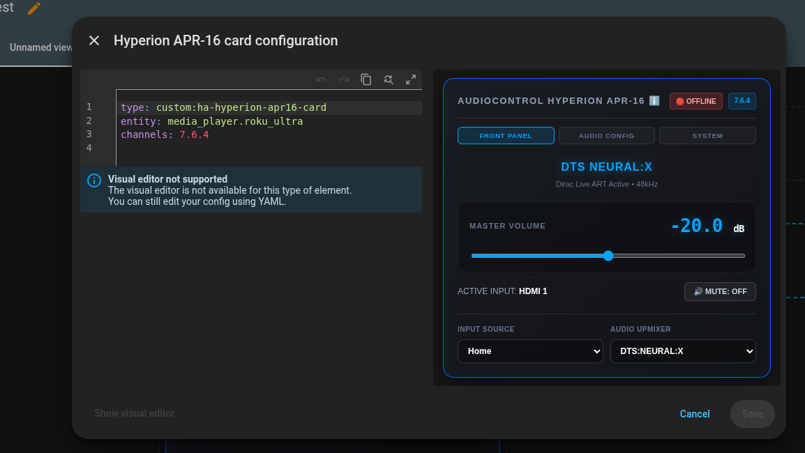
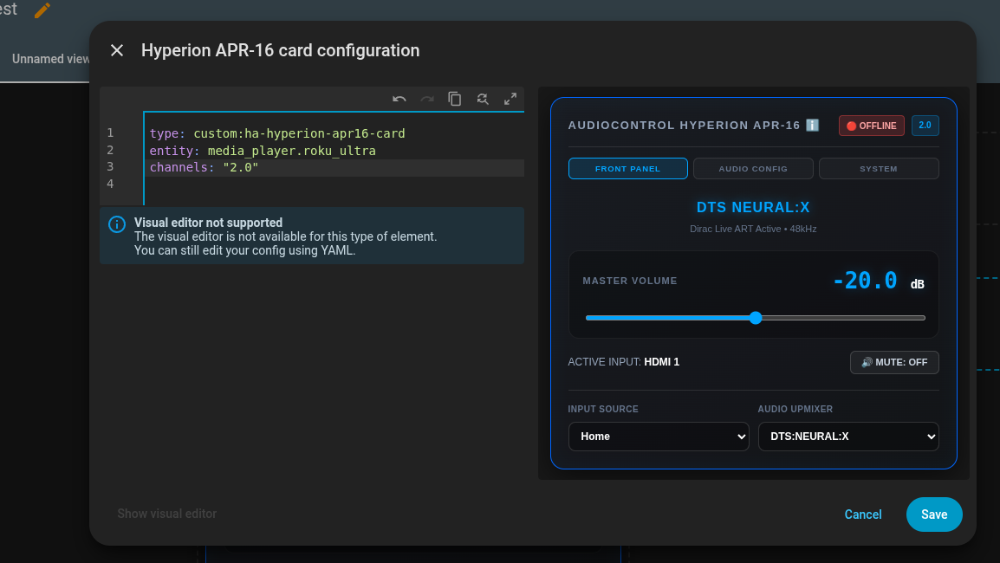
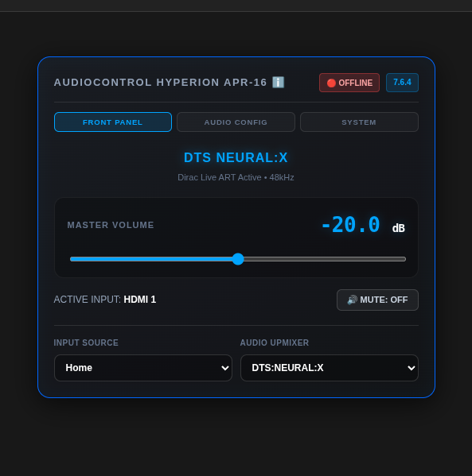
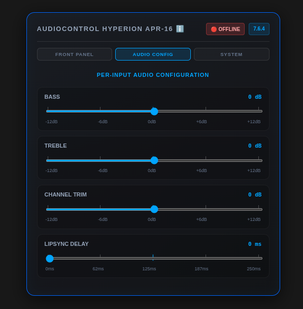
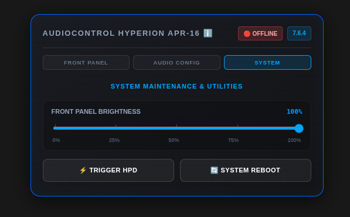
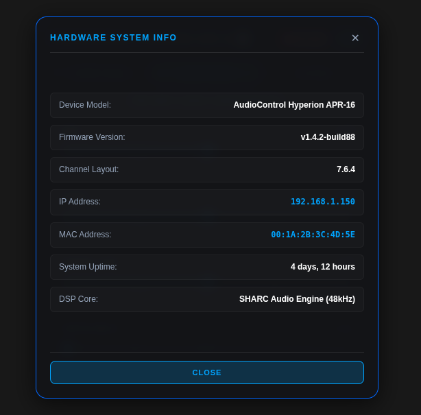

## Home Assistant Companion Card for the AudioControl Hyperion Apr16

[](https://github.com/fattykidd/ha-hyperion-apr16-card/releases)
[](LICENSE)

A custom [Home
Assistant](https://www.home-assistant.io/) Lovelace card emulating the 7-inch obsidian glass front-panel touch interface of the [Hyperion Apr-16](https://www.avproglobal.com/products/acp-hype-apr-16) Immersive Sound Pre-Amp Processor.

## Features
- **Obsidian Glass UI:** Dark charcoal glass styling with electric blue (`#0066ff` / `#00a5ff`) accents and precision track ticks.
- **3-Tab Navigation:** Seamless switching between **Front Panel**, **Audio Config**, and **System** maintenance views.
- **Interactive Controls:** Live master volume slider, power badge toggles, mute states, and dynamic input source / upmixer dropdowns.
- **Precision EQ & Trims:** Center-zero sliders ($\pm 12$ dB) for Bass, Treble, and Channel Trim with highlighted unity gain ticks.
- **System Utilities:** 10%-stepped Display Brightness slider, HPD trigger action, and safe system reboot buttons.
- **Hardware Info Modal:** Clickable brand header opening a comprehensive device status overlay.

---

## Installation

### Via HACS (Recommended)
1. Open HACS in your Home Assistant instance.
2. Click on **Frontend**.
3. Click the three dots in the top right corner and select **Custom repositories**.
4. Add your GitHub repository URL (`https://github.com/fattykidd/ha-hyperion-apr16-card`), category **Lovelace**, and click **Add**.
5. Find **Hyperion APR-16 Card** in HACS and click **Install**.

### Manual Installation
1. Download `ha-hyperion-apr16-card.js` from the latest release.
2. Place it in your Home Assistant `config/www/` directory.
3. Add the resource to your dashboard resources:
   ```yaml
   url: /local/ha-hyperion-apr16-card.js
   type: module
   ```
### Speaker Layout Configuration
User defined via the yaml configuration step.

```yaml
type: custom:ha-hyperion-apr16-card
entity: media_player.hyperion_apr16
channels: "7.6.4"
```


```yaml
type: custom:ha-hyperion-apr16-card
entity: media_player.hyperion_apr16
channels: "2.0"
```


## Screenshots In Action

 
 

## Acknowledgements and Attributions 

* **[Home Assistant](https://www.home-assistant.io/)** — For providing an incredible, extensible open-source home automation platform.
* **[AudioControl](https://www.audiocontrol.com/)** — For crafting phenomenal home theater processing hardware.
* **The Open-Source Community** — To all the unpaid developers and hobbyists whose passion and dedication make custom hardware integrations possible.
* **Gemini** — For architectural collaboration, troubleshooting, and code structure assistance throughout development.